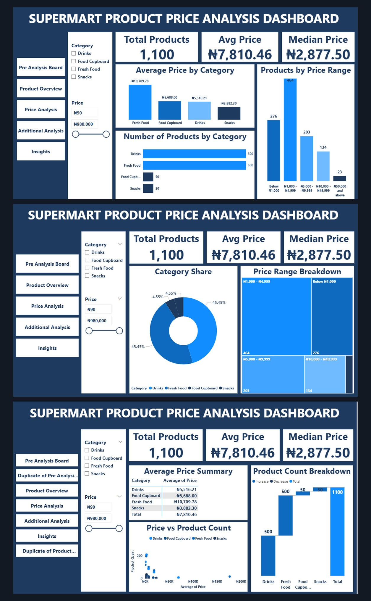

# SUPERMART PRODUCT PRICE ANALYSIS

## Project Overview

This personal data analytics capstone project explores supermarket product prices in Nigeria using web scraping, Python data analysis, and interactive Power BI dashboards.

## Project Objectives

- Collect supermarket product data using web scraping.
- Clean and prepare the dataset for analysis.
- Analyse product prices across different categories.
- Identify pricing patterns and potential outliers.
- Develop interactive Power BI dashboards.
- Provide insights and recommendations to support decision-making.

  ## Tools and Technologies

- **Python:** Data collection, cleaning, and analysis.
- **Requests:** Retrieving website HTML content.
- **BeautifulSoup:** Extracting product information from HTML.
- **Pandas:** Data cleaning, manipulation, and exploratory data analysis.
- **Jupyter Notebook:** Writing and executing Python code.
- **Power BI:** Creating interactive dashboards and visualisations.
- **DAX:** Creating calculated measures and key performance indicators.

  ## Project Methodology

This project followed five main steps: data collection, data cleaning, data analysis, dashboard development, and reporting.

### 1. Data Collection (Web Scraping)

I collected product information from Supermart.ng, an online supermarket in Nigeria.

Instead of copying product information manually, I used Python to collect the data from the website.

- **Requests:** Used to get the website's HTML content.
- **BeautifulSoup:** Used to find and extract product information.
- **Pandas:** Used to arrange the collected information into a table.

The dataset contains 1,100 product listings from four categories:

- Drinks: 500 products
- Fresh Food: 500 products
- Food Cupboard: 50 products
- Snacks: 50 products

The information collected included Product Name, Price, and Category.

### 2. Data Cleaning

After collecting the data, I used Python and Pandas to prepare it for analysis.

I checked for missing values, duplicate records, incorrect data types, and formatting problems.

I also prepared the price column for numerical analysis and saved the cleaned dataset as a CSV file.

The final dataset contains 1,100 product records with no missing values or exact duplicate rows.

### 3. Exploratory Data Analysis (EDA)

I analysed the cleaned dataset to understand the products and their prices.

I calculated the average price, median price, most common price, minimum price, and maximum price.

I also compared prices across categories, examined different price ranges, and identified unusually high-priced products.

### 4. Power BI Dashboard Development

After completing the Python analysis, I imported the cleaned data into Power BI.

I created three main dashboard pages:

**Product Overview**

This page gives a general summary of the products, categories, and important price measures.

**Price Analysis**

This page helps users understand price differences, compare product categories, and explore how prices are distributed.

**Additional Analysis**

This page provides further price comparisons and helps users identify patterns and unusual values.

I also used DAX measures, charts, and navigation buttons to make the report easier to explore.

### 5. Reporting

I reviewed the analysis and dashboard results to identify important findings.

I then prepared a detailed report explaining the methods, results, limitations, and recommendations.

## Key Findings and Insights

### 1. Average Price Is Higher Than the Median

The average product price was ₦7,810.46, while the median price was ₦2,877.50.

This means that some very expensive products increased the overall average.

The median gives a better idea of the price of a typical product in this dataset.

### 2. Most Products Cost Below ₦5,000

A total of 740 products, representing 67.3% of the dataset, were priced below ₦5,000.

This shows that most products in the collected data were in the lower price ranges, even though some products were very expensive.

### 3. Fresh Food Had the Highest Average Price

Fresh Food recorded the highest average price at ₦10,709.78.

Snacks recorded the lowest average price at ₦3,882.30.

However, this does not mean every Fresh Food product was more expensive than products in other categories.

### 4. Some Products Had Unusually High Prices

The analysis identified 88 high-price outliers, representing 8% of the dataset.

The highest recorded product price was ₦980,000.

These unusually high prices should be checked carefully because they can affect the average price.

### 5. Category Sizes Were Different

Drinks and Fresh Food had 500 records each, while Food Cupboard and Snacks had 50 each.

This difference is important when comparing categories because larger categories contribute more records to the overall results.

## Business Recommendations

### 1. Use Both Average and Median Prices

Businesses should consider both the average and median when reviewing product prices.

This will help them understand typical prices without being misled by a few expensive products.

### 2. Investigate Unusually Expensive Products

Products with extremely high prices should be checked to confirm their price, package size, and product details.

This will help identify possible data errors or products that are genuinely expensive.

### 3. Compare Products Within Their Categories

Businesses should use category filters to compare similar products.

This makes it easier to understand price differences without mixing unrelated products.

### 4. Keep Product Data Accurate and Updated

Product names, categories, and prices should be checked regularly.

Accurate data helps businesses make more reliable decisions.

### 5. Consider the Number of Products in Each Category

When comparing categories, businesses should consider how many products were collected from each category.

This helps prevent misleading conclusions when some categories have more records than others.

## Project Limitations

This project analysed product prices collected from selected Supermart.ng pages.

The dataset does not contain sales, profit, customer demand, or historical price information.

Therefore, the findings describe product listing prices and should not be used to make conclusions about sales performance or customer buying behaviour.

## Conclusion

This project helped me practise a complete data analytics process, from web scraping and data cleaning to exploratory analysis and Power BI dashboard development.

The analysis showed how product prices differ across categories, why unusually high prices matter, and how dashboards can make data easier to understand.

The project also demonstrates my ability to use Python, Pandas, Power BI, and DAX to turn raw data into useful information.

 ## Project Files and Links

You can explore the files used in this project below:

- [Python Notebook](P%20Capstone%20Project.ipynb) — Contains the Python code used for web scraping, data cleaning, and analysis.

- [Cleaned Dataset](supermart_cleaned.csv) — Contains the 1,100 cleaned product records.

- [Power BI Dashboard](PERSONAL%20PROJECT%20CAPSTONE.pbix) — Download this file to explore the interactive dashboard in Power BI Desktop.

- [Dashboard Screenshot](Supermart_Portfolio_Ready.jpg) — View the dashboard preview.

- [Final Project Report](Supermart_Capstone_Personal_Final_Report.pdf) — Read the detailed project explanation, findings, and recommendations.

## Data Source

Website: [Supermart.ng](https://www.supermart.ng/)

## Project Author

**Fadeyi Deborah Omotanwa**

Data Analytics Capstone Project | Vephla University
